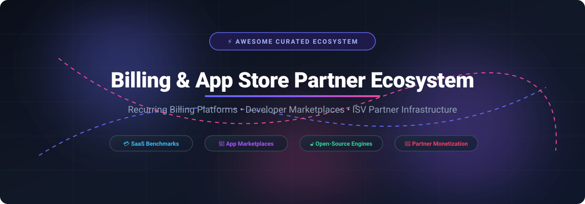

<p align="center">
  
</p>

# 🚀 Awesome Billing & App Store Partner Ecosystem

<p align="center">
  <a href="https://github.com/ishandutta2007/Awesome-Awesome-Awesome"></a>
  <a href="https://discord.gg/jc4xtF58Ve"></a>
  <a href="https://github.com/ishandutta2007/Awesome-Billing-App-Store-Partner-Ecosystem/stargazers"></a>
  <a href="https://github.com/ishandutta2007/Awesome-Billing-App-Store-Partner-Ecosystem/network/members"></a>
  <a href="https://github.com/ishandutta2007/Awesome-Billing-App-Store-Partner-Ecosystem/blob/main/LICENSE"></a>
  <a href="https://github.com/ishandutta2007"></a>
</p>

> 📌 **A curated directory and analytical guide to recurring billing engines, developer app store marketplaces, ISV partner programs, subscription management platforms, and open-source monetization architecture.**

---

## 📑 Table of Contents
- [📊 Sector Overview & Market Dynamics](#-sector-overview--market-dynamics)
- [💳 SaaS Billing Platforms & Partner Ecosystems](#-saas-billing-platforms--partner-ecosystems)
- [🔓 Open-Source Billing & App Store Infrastructure](#-open-source-billing--app-store-infrastructure)
- [💡 Choosing the Right Ecosystem for Your Stack](#-choosing-the-right-ecosystem-for-your-stack)
- [⭐ Star History](#-star-history)
- [💖 Support & Sponsorship](#-support--sponsorship)
- [🤝 Contributing](#-contributing)

---

## 📊 Sector Overview & Market Dynamics

The global subscription billing and recurring management market is estimated between **$7.2 billion and $8.3 billion**, projected to expand at a **CAGR of 11% to 15%** past **$20+ billion** over the next decade. 

Structurally, the ecosystem exhibits a dual dynamic:
* **Fragmented Tail:** The small-to-medium enterprise (SME) and boutique plugin tier is **moderately to highly fragmented** due to low barriers for basic recurring invoicing and lightweight payment gateways.
* **Concentrated Core:** The upper mid-market and enterprise tier is **heavily concentrated (winner-take-most / oligopolistic)**, dominated by platforms like Stripe, Intuit, Zuora, and Chargebee. Enterprise switching costs are exceptionally high due to regulatory compliance (ASC 606 / IFRS 15 revenue recognition), complex ERP integrations, global tax engines, and hybrid usage-based metering.

---

## 💳 SaaS Billing Platforms & Partner Ecosystems

The table below outlines leading SaaS billing, accounting, and workflow automation platforms featuring developer app stores and partner programs. Sorted in **descending order by company scale (Valuation / Market Cap)**:

| SaaS Product | 🏢 Company Size (Valuation / Revenue) | 💵 Starting Pricing Tier | 🎁 Free Tier / Free Trial Limits | 🤝 Partner & App Store Ecosystem Model |
| :--- | :--- | :--- | :--- | :--- |
| **Stripe**<br>*(Stripe Billing & App Marketplace)* | **$159B Valuation** (2026 tender offer) / ~$6.8B net revenue | **$0/mo** + 0.7% of recurring billing volume (Pay-as-you-go); or **$620/mo** committed tier (covers up to $100k/mo volume) | **Free test mode forever** (unlimited API testing in sandbox); 0-day platform charge for sandbox; standard 30-day merchant trials supported with zero extra platform fee | Free registration for Stripe App Marketplace; apps embed directly into the Stripe Dashboard. |
| **QuickBooks**<br>*(Intuit Developer / App Store)* | **~$93B Market Cap** / $21.45B annual revenue (FY26) | **$38/mo** (Simple Start tier, 1 user + 2 accounting firms) | **30-day free trial** with full feature access (or restricted $0/mo QuickBooks Free basic tracking plan) | Free developer portal registration with zero per-call charges; app store revenue share on referred subscriptions is negotiated per partner app. |
| **Make**<br>*(Celonis / Make Community Apps)* | **$13B Valuation** (Parent Celonis) / ~$53M ARR | **$9/mo** (Core Plan billed annually; 10,000 ops/mo, unlimited scenarios) | **Free forever plan**: 1,000 operations/month, max 2 active scenarios, minimum 15-minute scheduling interval, 512 MB transfer | **100% revenue kept by the partner**; partner program requires a signed Partnership Agreement (beta, partner-only submission). |
| **Xero**<br>*(Xero App Store)* | **~$11B Market Cap** / NZD $2.8B (~$1.7B USD) FY26 revenue | **$27/mo** (US Early Plan) / **A$37/mo** (AU Ignite Plan) | **30-day free trial** (unlimited access to core reconciliations and invoicing; no credit card required upfront) | Developer portal tiers: **Starter (Free, 5 connections)**, Core (A$35/mo, 50 connections). **App Store listing requires Plus tier (A$245/mo, 1,000 connections)** or Advanced (A$1,445/mo); egress overage A$2.40/GB. Flat-fee infrastructure model replaced rev-share. |
| **Chargebee**<br>*(Chargebee Partner Network)* | **$3.5B Valuation** (Series H) / ~$250M ARR | **$0/mo** (Starter Plan until cumulative limit reached); or **$599/mo** (Performance tier) | **Free forever Starter Plan up to $250,000 in cumulative lifetime billing**; 0.75% overage fee applies on volume exceeding $250k | No partner membership fee; supports ISV, Solution, and Reseller partner tracks with referral commissions, reseller margins, and deal registration. |

---

## 🔓 Open-Source Billing & App Store Infrastructure

For engineering teams requiring self-hosted sovereignty, zero vendor lock-in, custom billing workflows, or self-hosted app store distribution. Repositories are sorted in **descending order by GitHub_Stars_Count**:

| Open-Source Project | 🌟 GitHub_Stars | 📖 Description | 🛠️ Architecture & Best For |
| :--- | :--- | :--- | :--- |
| **[Nextcloud Server](https://github.com/nextcloud/server)** | [](https://github.com/nextcloud/server/stargazers) | Self-hosted productivity platform featuring a mature ISV App Store ecosystem with over 600+ deployable apps. | PHP / Vue / Docker. Ideal for developers building self-hosted enterprise apps with direct developer-to-customer software licenses. |
| **[Medusa](https://github.com/medusajs/medusa)** | [](https://github.com/medusajs/medusa/stargazers) | Modular, headless digital commerce engine with customizable billing, payment plugin framework, and multi-currency support. | Node.js / TypeScript. Best for composable commerce, modular checkout flows, and plugin-based digital marketplaces. |
| **[Saleor](https://github.com/saleor/saleor)** | [](https://github.com/saleor/saleor/stargazers) | High-performance, headless GraphQL-first e-commerce and multi-channel billing platform with an integrated App Store extension architecture. | Python / Django / GraphQL. Best for modern headless storefronts, app extensions, and complex multi-channel transaction routing. |
| **[Lago](https://github.com/getlago/lago)** | [](https://github.com/getlago/lago/stargazers) | Open-source metering and usage-based subscription billing platform designed as an open-source alternative to Stripe Billing and Chargebee. | Ruby on Rails / Go. Best for modern B2B SaaS, hybrid subscription-plus-metered pricing models, and customizable rate plans. |
| **[Invoice Ninja](https://github.com/invoiceninja/invoiceninja)** | [](https://github.com/invoiceninja/invoiceninja/stargazers) | Leading open-source invoicing, recurring billing, payments, and time-tracking application built for freelancers and SMEs. | PHP / Laravel / Flutter. Best for self-hosted customer billing, invoice generation, and multi-gateway merchant payments. |
| **[Crater](https://github.com/crater-invoice-inc/crater)** | [](https://github.com/crater-invoice-inc/crater/stargazers) | Open-source invoicing suite designed for small businesses and individuals to track expenses, generate payments, and manage client billing. | Laravel / Vue.js / Mobile. Best for lightweight self-hosted invoicing with mobile and web clients. |
| **[Kill Bill](https://github.com/killbill/killbill)** | [](https://github.com/killbill/killbill/stargazers) | Enterprise-grade open-source subscription billing and payments platform designed for complex invoice management and gateway routing. | Java / OSGi modular plugins. Best for high-scale enterprise systems requiring full control over multi-tenant financial data pipelines. |
| **[OpenMeter](https://github.com/openmeterio/openmeter)** | [](https://github.com/openmeterio/openmeter/stargazers) | Cloud-native, high-throughput usage metering engine for AI applications, token counting, and consumption-based billing models. | Go / Apache Kafka / ClickHouse. Best for real-time usage-based billing, AI API metering, and high-frequency event ingestion. |
| **[Mercur](https://github.com/mercurjs/mercur)** | [](https://github.com/mercurjs/mercur/stargazers) | Multi-vendor commerce marketplace platform built on top of MedusaJS with zero transaction fees and complete code ownership. | MedusaJS / TypeScript. Best for launching multi-vendor marketplaces with vendor commissions, split payouts, and custom merchant portals. |

---

## 💡 Choosing the Right Ecosystem for Your Stack

```
                                    ┌────────────────────────┐
                                    │ What is your primary   │
                                    │ monetization model?    │
                                    └───────────┬────────────┘
                                                │
                 ┌──────────────────────────────┴──────────────────────────────┐
                 ▼                                                             ▼
       [ Proprietary SaaS ]                                           [ Self-Hosted / OSS ]
                 │                                                             │
    ┌────────────┴────────────┐                                   ┌────────────┴────────────┐
    ▼                         ▼                                   ▼                         ▼
[ Developer App Store ]  [ Direct Billing API ]               [ Usage / Metering ]     [ Modular Marketplace ]
  • Stripe Marketplace     • Chargebee ($250k free)             • Lago (10.7k★)          • Medusa (37.1k★)
  • QuickBooks App Store   • Stripe Billing                     • OpenMeter (2.4k★)      • Mercur (1.8k★)
  • Xero (Plus tier)       • Intuit Payments                    • Kill Bill (5.8k★)      • Nextcloud (37.4k★)
```

---

## ⭐ Star History

[](https://www.star-history.com/#ishandutta2007/Awesome-Billing-App-Store-Partner-Ecosystem&type=date&legend=top-left)

---

## 💖 Support & Sponsorship

Thank you for visiting and supporting the **Awesome Billing & App Store Partner Ecosystem** project! 🙏

If you found this resource helpful, please consider:
* ⭐ **Starring** the repository on GitHub to help other developers discover it.
* 🍴 **Forking** the repo and submitting pull requests to keep partner fees and open-source data up to date.
* 📢 **Sharing** this guide with your developer community, colleagues, and SaaS founders.
* ☕ **Buying a coffee & sponsoring ongoing maintenance**: Support the author directly via the [GitHub Sponsor Dashboard](https://github.com/sponsors/ishandutta2007).

---

## 🤝 Contributing

Contributions, updates to partner fee models, and additions of emerging open-source billing engines are welcome! Please feel free to open an issue or submit a pull request.
